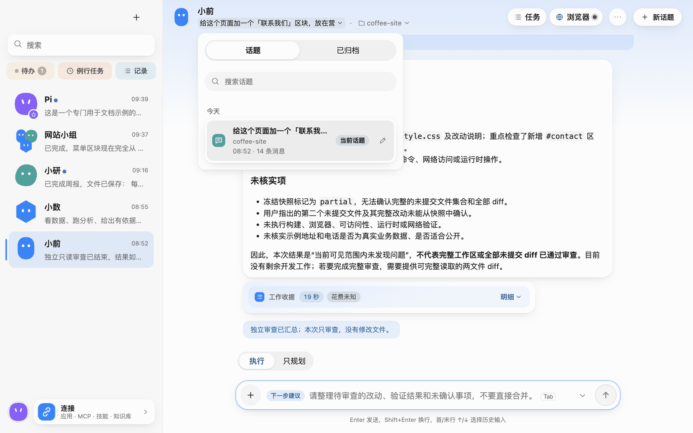
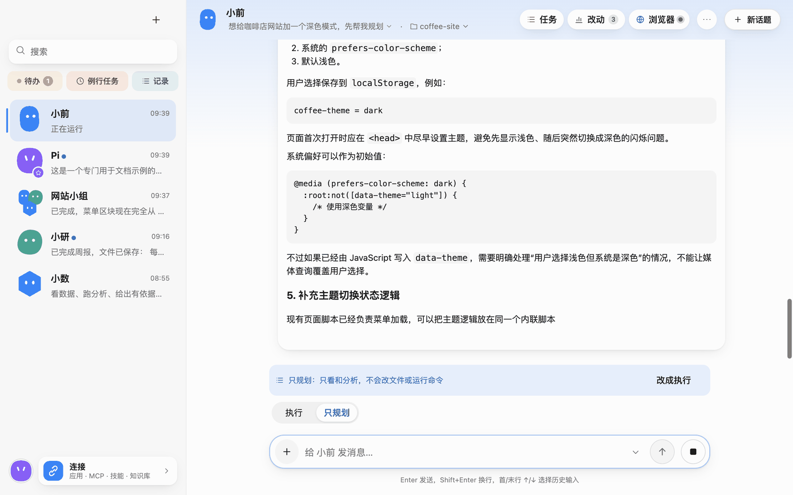
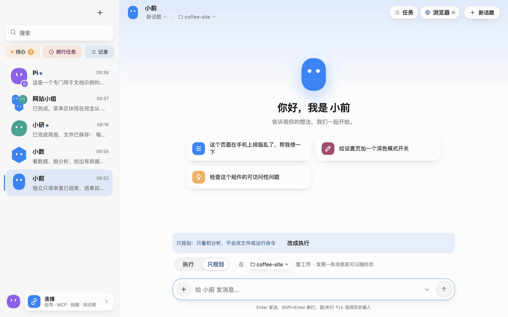
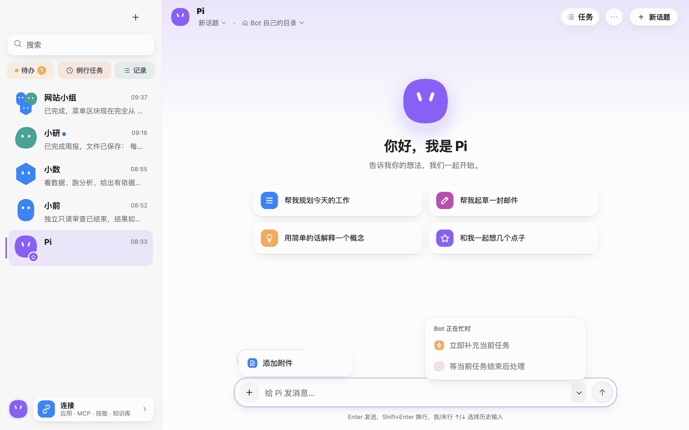
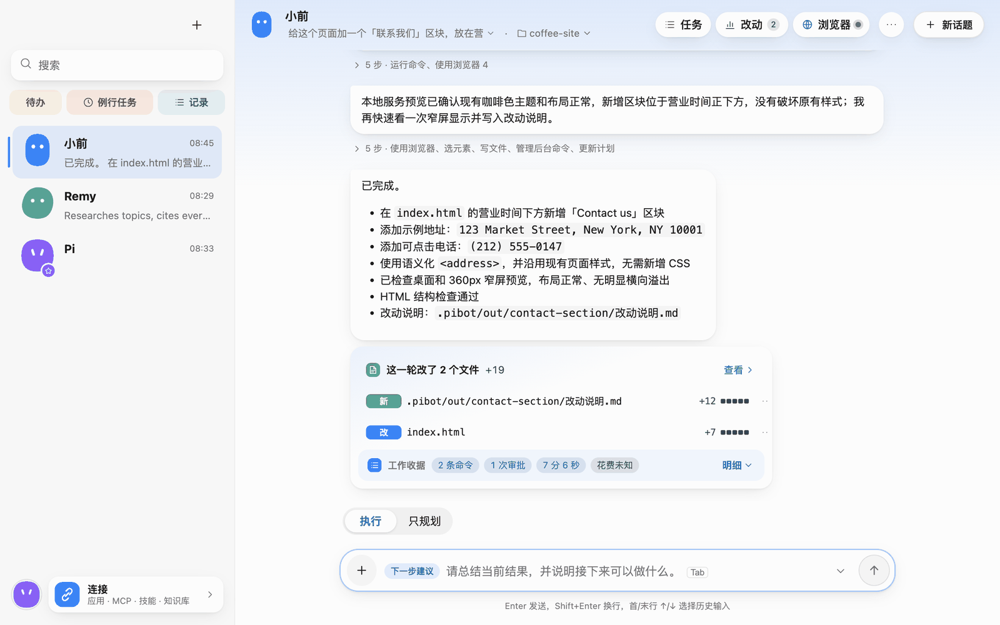
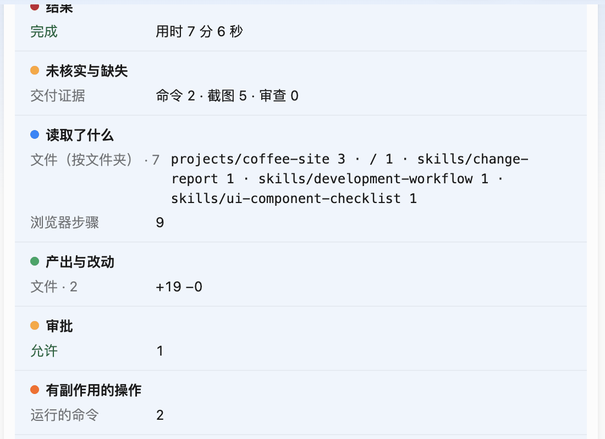
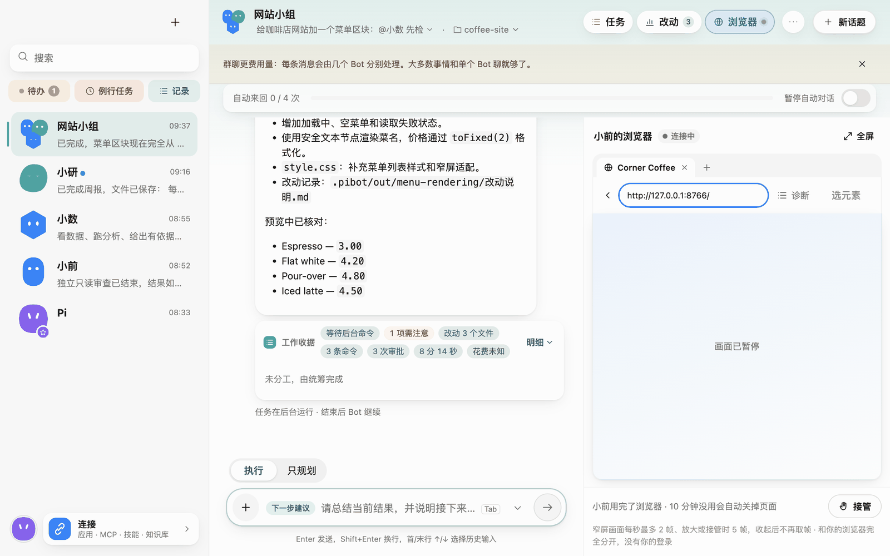

# 3 · 聊天

和 Bot 私聊就是给它派活。Bot 会先说打算怎么做，然后读文件、跑命令、看网页，需要时停下来问你，最后交付结果和一份工作收据。

本页内容：

- [话题](#话题)
- [执行与只规划](#执行与只规划)
- [发消息、附件和停止](#发消息附件和停止)
- [看懂一次运行](#看懂一次运行)
- [工作收据](#工作收据)
- [后台命令](#后台命令)
- [Bot 的浏览器](#bot-的浏览器)

## 话题

每个 Bot 的聊天按**话题**分开。一个话题有自己的上下文和工作文件夹。

- **新话题**：点右上角「＋ 新话题」。新话题显示问候页和几条建议，建议跟着界面语言走，点一下就能填进输入框。
- **切换话题**：点聊天顶部 Bot 名字下面的话题名，打开话题列表，可以搜索，也能看「已归档」。

  

- **归档**：右上角「…」›「归档」，收起这个话题，保留聊天和附件。

  

## 执行与只规划

输入框上方有两个模式：

- **执行**：Bot 可以按权限改文件、跑命令。
- **只规划**：只看和分析，不会改文件或运行命令。适合先让 Bot 出方案，满意了再点「改成执行」。

「执行 / 只规划」和工作文件夹在同一行：新话题发出第一条消息之前，可以在「在 … 里工作」处换文件夹（见 [4 · 工作文件夹与改动](04-folders-and-changes.md)）。

## 发消息、附件和停止

- **发送**：Enter 发送，Shift+Enter 换行；在第一行或最后一行按 ↑ / ↓ 可以翻出之前输入过的内容。
- **附件**：点输入框左边的「＋」›「添加附件」。
- **Bot 正在忙时**：点发送按钮旁的箭头，可以选「立即补充当前任务」或「等当前任务结束后处理」。

  

- **停止**：Bot 运行时，发送按钮变成停止按钮；群聊里每个成员旁边也有「停止 … 的这次运行」。停止后，已经生成的内容会保留。
- **下一步建议**：一次运行结束后，输入框里会出现灰色的「下一步建议」。按 Tab 采纳、Esc 隐藏；采纳后仍需你手动发送。

## 看懂一次运行

- **计划**：多步任务开始时 Bot 会列一个计划，随进度打勾。
- **步骤折叠行**：例如「5 步 · 运行命令、使用浏览器 4」，点开可以看每一步做了什么。
- **审批卡**：需要你同意的操作会在聊天里弹出卡片（见 [5 · 审批与权限](05-approvals-and-permissions.md)）。
- **改动清单**：「这一轮改了 2 个文件」，点「查看」打开改动面板（见 [4 · 工作文件夹与改动](04-folders-and-changes.md)）。
- **网页结果**：开发任务做出网页、本地 HTML 或 Web 服务后，Bot 会在自己的浏览器里打开检查；画面类结果会先截图自查，有明显错位先修好再交给你。

## 工作收据

每次运行结束都有一行「工作收据」，列出命令数、审批数、用时和花费。点「明细」展开：

- **结果**：完成、停止或失败，用了多久。
- **未核实与缺失**：交付证据（命令、截图、审查次数），没验证的会标出来。
- **读取了什么**：按文件夹统计读过的文件、浏览器步骤、用到的记忆。
- **产出与改动**：改了多少文件、多少行。
- **审批**：允许、拒绝各几次。
- **有副作用的操作**：运行的命令、被拦下的步骤。
- **花费**：模型、请求次数、费用（厂商没有提供价格时显示「未知」）、实际工作时间。

收据根据这台电脑上的记录生成（审计、改动、审批、预算、计划），不含对话正文和文件内容。

## 后台命令

Bot 可以把命令放到后台运行，例如本地预览服务。聊天里会出现一张「后台运行中」的卡片，显示输出行数和运行时间，可以「在 Bot 浏览器打开」端口、「查看输出」或「停止」。

> 截图待补：中文界面的「后台运行中」卡片。

后台命令默认最多运行 2 小时（设置 › 通用 › 后台命令 › 总时长上限），你停止、删除聊天、归档 Bot 或退出应用时也会结束；只能监听本机地址 127.0.0.1。启动后台命令每次都要你确认。

## Bot 的浏览器

点聊天顶部的「浏览器」打开 Bot 浏览器面板，可以看到 Bot 正在看的网页。

- 它和你自己的浏览器完全分开，没有你的登录。
- 「接管」可以自己操作这个页面；「全屏」放大查看；「诊断」「选元素」用于检查网页。
- 窄屏画面每秒最多 2 帧，放大或接管时 5 帧，收起后不再取帧。Bot 用完 10 分钟后会自动关掉页面。
- Bot 浏览器默认不能访问本机和内网地址；Bot 自己启动的本地预览服务，可以从后台命令卡片上的「在 Bot 浏览器打开」打开。
